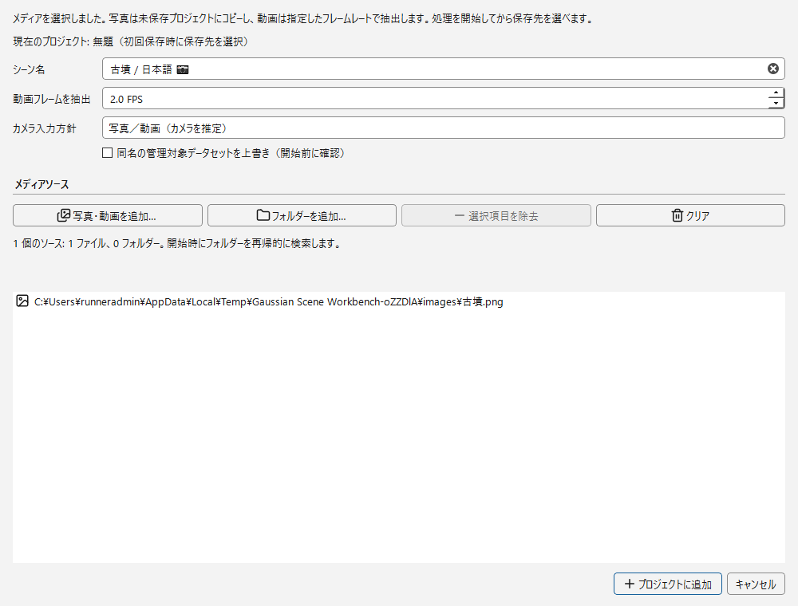
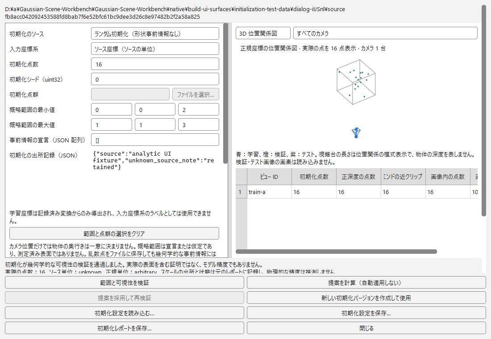
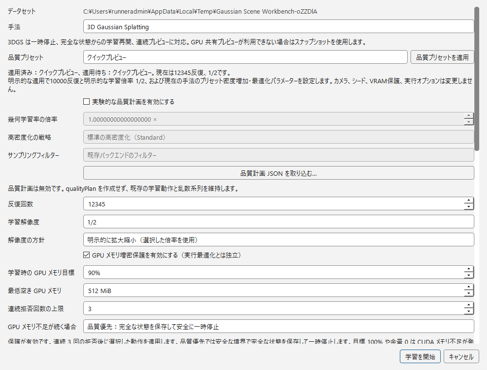
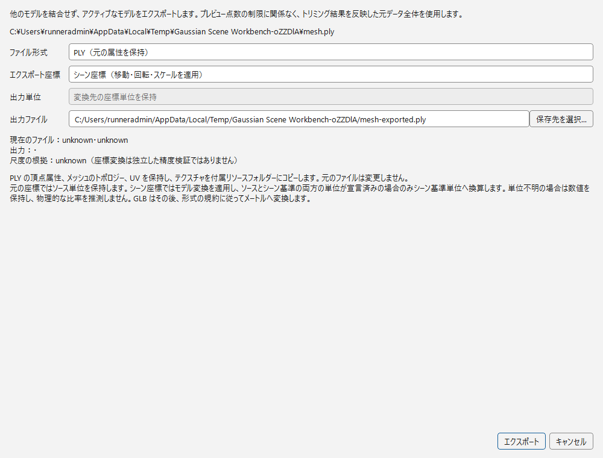

  

<h1 align="center" lang="en">Gaussian Splatting Workbench</h1>

  <strong>写真と既知カメラから、編集可能なガウスシーンへ。</strong>

  
  
  

  <a href="README.md" lang="en">English</a> · <a href="README.zh-CN.md" lang="zh-CN">简体中文</a> · <strong lang="ja">日本語</strong>

  <a href="README_RELEASE.md#日本語"><strong>Windows プレビューを入手</strong></a> ·
  <a href="docs/README.md">ドキュメント</a> ·
  <a href="native/README.md">ソースからビルド</a> ·
  <a href="https://github.com/fubukisama/Gaussian-Scene-Workbench/issues">不具合を報告</a>

---

<strong lang="en">Gaussian Splatting Workbench (GSW)</strong> は、写真測量、3DGS / 2DGS 学習、複数モデルの編集、出所を追跡できる出力をつなぐ Windows ネイティブアプリです。写真・動画から始めるほか、外部で求めたカメラ情報や既存モデルを使って作業できます。

[GSWの特長](#gswの特長) · [入力から選ぶ](#入力から選ぶ) · [主な機能](#主な機能) · [はじめに](#はじめに) · [ドキュメント](#ドキュメント)

## 画面で見るワークフロー

画像をクリックすると原寸で確認できます。コンセプト画像ではなく、実際のアプリ画面です。

<table>
<tr>
<td width="50%"><strong>1. 写真・動画を追加</strong> </td>
<td width="50%"><strong>2. 初期化を確認</strong> </td>
</tr>
<tr>
<td width="50%"><strong>3. 学習設定を点検</strong> </td>
<td width="50%"><strong>4. 別の成果物として出力</strong> </td>
</tr>
</table>

[2DGS の設定画面を見る](docs/images/readme/ja/training-2dgs.png) · [画像の出所とハッシュ](docs/images/README.md#workflow-ui-gallery)

公開 CI で独立した合成入力を使って取得した実際の画面です。旧製品名のビルド `ac5c77b`（2026-10-29）に由来し、操作項目を示すもので、学習の実行、GPU 性能、現行ビルドの配布検証、再構築品質を示しません。数値と実行環境のパスはテスト用であり、推奨設定や利用者のデータではありません。

複数形式を混在させたビューポートの例

複数形式を混在させた合成回帰シーンの実際の画面（2026-10-27）。この旧版の画像はレイヤー表示の例であり、現在の UI の受入検証や再構築品質を示すものではありません。[画像の出典](docs/images/README.md)。

## GSWの特長

### 実験全体を一つにつなぐ

データセット、再構築、学習タスク、成果物を同じプロジェクトに関連付けます。進捗を確認し、対応する学習を安全に一時停止し、以前のモデルを置き換えずに実験を比較できます。永続バッチタスクは、観察ウィンドウとは独立して処理を続けられます。

### カメラとスケールを、仮定ではなくデータとして扱う

完全な内部パラメーター、姿勢、データ分割を持つ既知カメラを取り込みます。固定カメラの経路では、SfM を暗黙に再実行しません。初期化、座標変換、スケール制約、独立検証を追跡可能に保ち、単位が不明なら不明のまま扱います。

### 元データを残して確認・編集する

ガウシアンモデル、2DGS surfel、点群、メッシュを同じビューポートで扱います。オブジェクトや対応形式の点を選択し、取り消し可能な変換・クロップを行い、別の成果物として出力します。ビューポートで編集しても、元ファイルや学習チェックポイントは書き換えません。

## 対象ユーザー

- **再構築の研究者：**入力、実効設定、カメラ方針、評価の出所をまとめて管理。
- **シーン編集者：**複数の成果物を確認し、対応モデルを調整して、形式に応じた出力を準備。
- **既知カメラを使う方：**キャリブレーション済み、合成、外部再構築由来のカメラ情報を、新たな SfM 問題として扱わずに利用。

GSW は汎用ソフトウェアです。小物体、室内、建築は対象となるワークフローであり、特定の実験条件を埋め込んだ固定テンプレートではありません。

## 入力から選ぶ

### 写真・動画

メディアを追加するかデータセットを関連付け、COLMAP でカメラを再構築してから 3DGS または 2DGS を学習します。疎な再構築・初期化から学習プレビュー・最終出力まで、段階ごとに確認できます。[取り込みと再構築](docs/WORKSPACE_DROP.md) · [学習と完全状態からの再開](docs/TRAINING_RESUME.md)

### 既知カメラ

カメラの規約、単位、学習／検証／テスト分割を確認し、学習前に初期化を選んで点検します。固定したカメラ解と記録済みの変換チェーンを、対応する出力経路まで保持します。[カメラと初期化](docs/CAMERA_SCALE_P0.md) · [既知距離・基線・制御点](docs/CAMERA_SCALE_P1.md)

### 既存モデル

対応する PLY / SPZ ファイルを取り込み、独立したレイヤーを比較し、表示状態や変換を調整して、再学習せずに出力します。[複数モデル](docs/MULTI_SCENE_IMPORT.md) · [座標と単位](docs/SCENE_COORDINATES.md)

## 主な機能

| ワークフロー | GSW でできること | 確認が必要な点 |
| --- | --- | --- |
| 表示・編集 | ガウシアン／2DGS、点群、メッシュのレイヤー表示、選択、変換、クロップ、取り消し | 元データの対応属性と、形式ごとの編集・出力制限 |
| 再構築 | 写真・動画の取り込み、データセットの関連付け、COLMAP タスク | 互換性のある外部 COLMAP・実行環境の導入 |
| 学習・再開 | ネイティブ 3DGS / 2DGS タスク、進捗、安全な一時停止、互換性のある完全状態からの再開 | バックエンドと入力の同一性。PLY を初期値とする再学習は完全状態の再開ではありません |
| 形状抽出 | 描画深度による点群と、オプションの TSDF、SuGaR / GS2Mesh 経路 | 各手法のカメラ・深度・実行環境・スケール要件。すべての経路がすべての入力に対応するわけではありません |
| 測定・比較 | 対応画像の PSNR / SSIM、独立した形状評価レポート。バックグラウンド／CLI ツールも含む | 有効な参照データ、位置合わせ、単位、データ分割、比較可能な測定設定 |

ガウシアンの出力には PLY / SPZ を使用できます。点群とメッシュには、それぞれの形式・属性に関する規則があります。ある形式への対応が、すべての表現で同じ機能を使えることを意味するわけではありません。[全パイプラインの対応表](docs/GENERATION_PIPELINES.md) · [形状生成の経路と制限](docs/MESH_GENERATION.md) · [ガウシアン出力の忠実性](docs/GAUSSIAN_PLY_BAKING.md)

## はじめに

1. **検証済みの Windows x64 プレビューを入手。** [ダウンロード・導入ガイド](README_RELEASE.md#日本語)、または[ネイティブアプリのビルド手順](native/README.md)を参照してください。ソース ZIP はインストーラーではありません。
2. **表示と計算のどちらを使うか選択。** 対応する既存モデルを開くだけなら、学習環境は不要です。再構築と学習には別途構成した実行環境を使い、CUDA 学習には互換性のある NVIDIA ハードウェアとバックエンド依存関係が必要です。[実行環境の設定](docs/WINDOWS_NATIVE_RUNTIME.md)
3. **小さなプロジェクトから開始。** モデルの取り込み、メディアの追加、既知カメラのデータセット検証から始め、長時間実行する前に実効設定と出力先を確認してください。

ネイティブ UI は **英語・簡体字中国語・日本語**に対応し、言語を即時に切り替えられます。必要なメモリ・GPU リソースは画像解像度、モデル規模、選択手法によって異なり、一律の VRAM 容量や品質を保証するものではありません。

> **プレビュー版の範囲：**互換性のある完全状態の再開は、ネイティブ 3DGS / 2DGS バックエンド固有の機能です。描画深度による形状は外観プロキシであり、認証済みの物理的な材質境界ではありません。タスクの完了、低い当てはめ残差、正常なプレビューだけでは、独立した形状精度は証明できません。

## ドキュメント

- **学習と実験：**[一時停止・再開](docs/TRAINING_RESUME.md) · [実行制御](docs/RUNTIME_DECOUPLING.md) · [品質測定](docs/TRAINING_QUALITY.md) · [永続バッチ](docs/RECORDED_PLY_AND_BATCH.md)
- **カメラと形状：**[既知カメラ](docs/CAMERA_SCALE_P0.md) · [スケール制約](docs/CAMERA_SCALE_P1.md) · [初期化・深度・評価](docs/GENERAL_RECONSTRUCTION.md)
- **デスクトップと配布：**[表示・ナビゲーション](docs/VIEWPORT_DISPLAY.md) · [大規模モデルの予算](docs/RESOURCE_BUDGETS.md) · [更新・ロールバック](docs/NATIVE_UPDATES.md) · [ソースからビルド](native/README.md)

[全ガイドを見る →](docs/README.md)

## フィードバックと開発

不具合の報告には、バージョン、関連設定、可能であれば公開しても差し支えない小さな再現用サンプルを添えてください。私的な写真、チェックポイント、認証情報を公開 Issue に投稿しないでください。[Issue 一覧](https://github.com/fubukisama/Gaussian-Scene-Workbench/issues) · [ネイティブ CI と診断](docs/NATIVE_CI.md)

## ライセンス

独自のネイティブ主プログラムは **GPL-3.0-or-later** です。対象外の独自コードと第三者コンポーネントは各ライセンスを維持します。Graphdeco の研究用バックエンドには別途非商用の制限があり、主プログラムの GPL は全バックエンドの商用許諾を意味しません。

[ライセンス案内](docs/LICENSING.md#日本語) · [適用範囲](native/LICENSE.md) · [リポジトリーのライセンス](LICENSE) · [第三者の通知](THIRD_PARTY_LICENSES.md)

