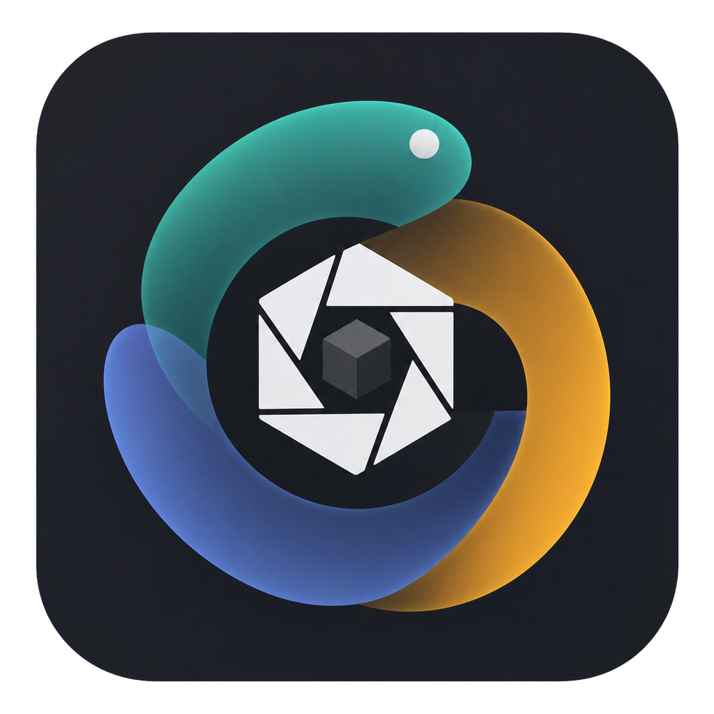
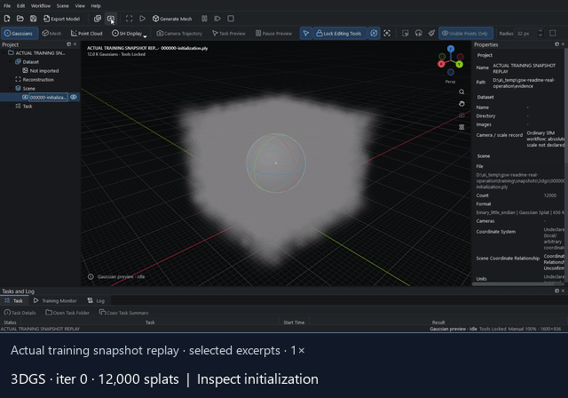
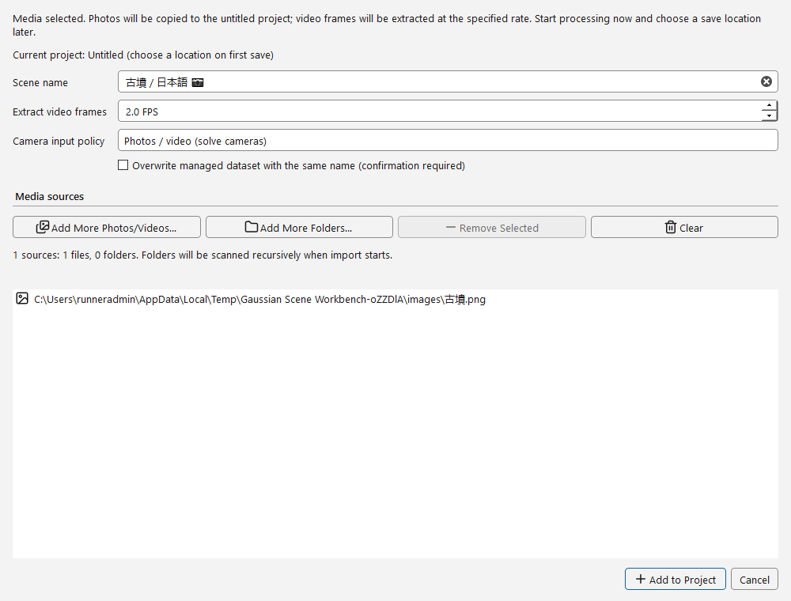
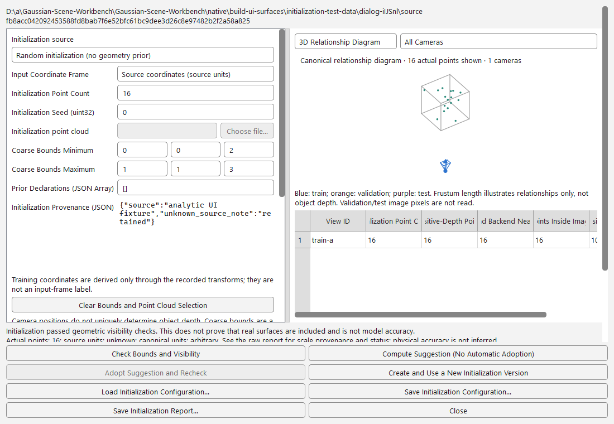
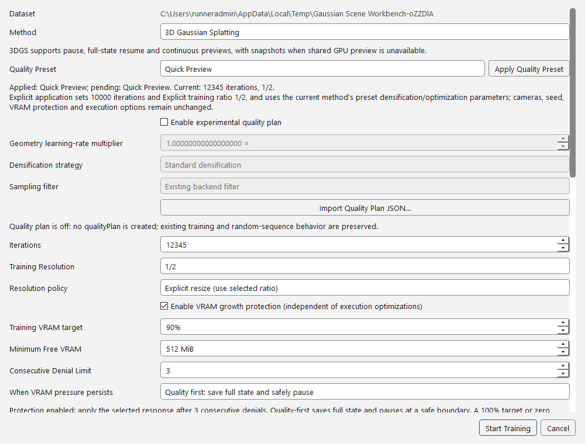
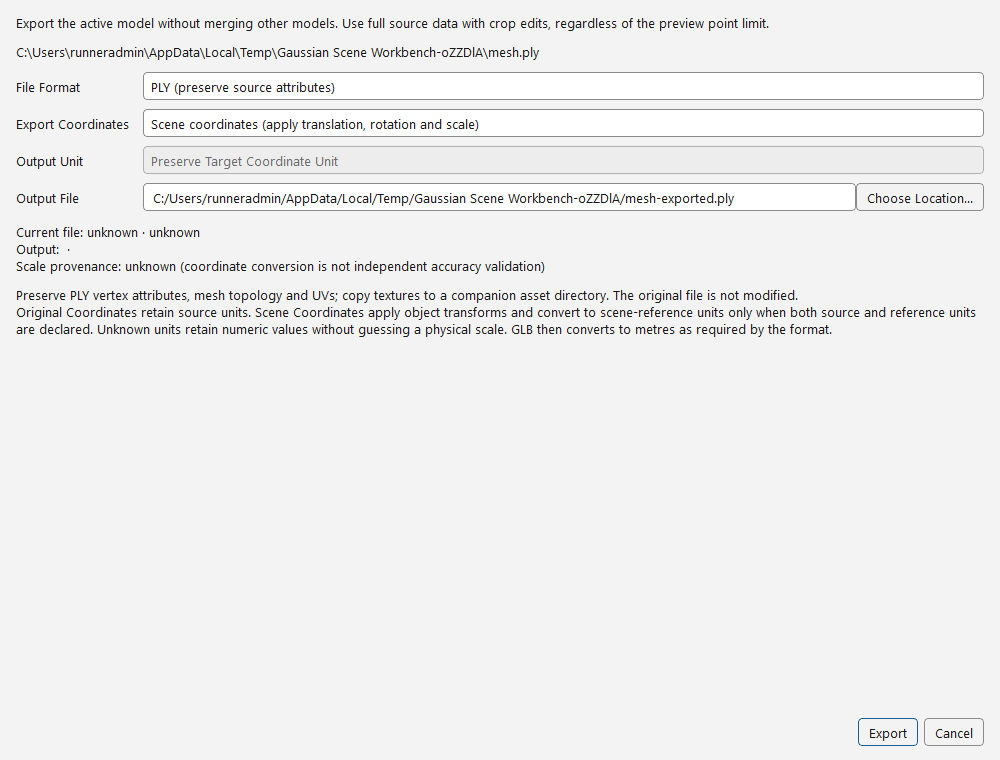
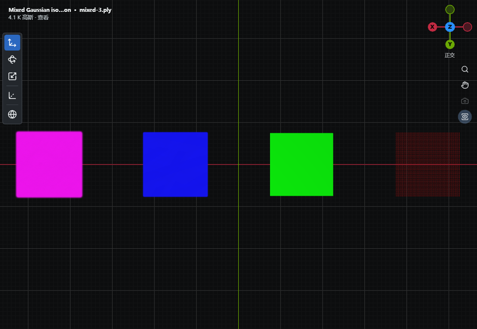

  

<h1 align="center" lang="en">Gaussian Splatting Workbench</h1>

  <strong>From photos and known cameras to editable Gaussian scenes.</strong>

  
  
  

  <strong lang="en">English</strong> · <a href="README.zh-CN.md" lang="zh-CN">简体中文</a> · <a href="README.ja.md" lang="ja">日本語</a>

  <a href="README_RELEASE.md"><strong>Get the Windows preview</strong></a> ·
  <a href="docs/README.md">Documentation</a> ·
  <a href="native/README.md">Build from source</a> ·
  <a href="https://github.com/fubukisama/Gaussian-Scene-Workbench/issues">Report a bug</a>

---

**Gaussian Splatting Workbench (GSW)** connects photogrammetry, 3DGS / 2DGS training, multi-model editing and traceable export in a native Windows application. Start with photos or video, preserve an external camera solution, or bring in a model you already have.

[Why GSW](#why-gsw) · [Choose your starting point](#choose-your-starting-point) · [Capabilities](#capabilities) · [Get started](#get-started) · [Documentation](#documentation)

## Watch it in action

See random initialization become actual 3DGS / 2DGS results, followed by native camera navigation, a move with undo, and PLY export.

[Full MP4 · 73 seconds](docs/media/gsw-native-operation.en.mp4) · [English subtitles](docs/media/gsw-native-operation.en.srt) · [Scene files and provenance](docs/media/README.md)

Actual GPU training on original synthetic images; saved-stage replay, not live training. The full English-UI video preserves real operation speed; the GIF selects excerpts. This short demonstration is not a quality, accuracy or speed benchmark.

## A visual tour

Click an image to inspect the full-size controls. These are real application screens, not mockups.

<table>
<tr>
<td width="50%"><strong>1. Add photos or video</strong> </td>
<td width="50%"><strong>2. Inspect initialization</strong> </td>
</tr>
<tr>
<td width="50%"><strong>3. Review training settings</strong> </td>
<td width="50%"><strong>4. Export a separate result</strong> </td>
</tr>
</table>

[View the 2DGS settings screen](docs/images/readme/en/training-2dgs.png) · [Capture source and image hashes](docs/images/README.md#workflow-ui-gallery)

Captured in public CI with independent synthetic inputs, from the previous-name build `ac5c77b` (2026-10-29). These examples show controls—not executed training, GPU performance, current-build delivery acceptance or reconstruction quality. Values and runner paths are test fixtures, not recommended settings or user data.

Mixed-model viewport example

Actual viewport capture from a synthetic mixed-model regression scene (2026-10-27). This older snapshot demonstrates layer display, not current UI acceptance or reconstruction quality. [Image provenance](docs/images/README.md).

## Why GSW

### Keep the whole experiment connected

Associate datasets, reconstruction, training jobs and results in one project. Monitor progress, pause compatible training safely, and compare experiments without replacing earlier models. Persistent batch tasks can continue independently of their observation window.

### Treat cameras and scale as data, not assumptions

Import known cameras with their full intrinsics, poses and data splits. The locked-camera route does not silently rerun SfM. Keep initialization, coordinate transforms, scale constraints and independent checks traceable; unknown units stay unknown.

### Inspect and edit alongside the original

Work with Gaussian models, 2DGS surfels, point clouds and meshes in one viewport. Select objects or supported point subsets, transform and crop with undo, then export a separate result. Existing source files and training checkpoints are not rewritten by viewport edits.

## Who it is for

- **Reconstruction researchers:** keep inputs, effective settings, camera policy and evaluation provenance together.
- **Scene editors:** inspect multiple results, adjust supported models and prepare format-specific exports.
- **Known-camera workflows:** bring calibrated, synthetic or externally reconstructed camera data without treating every input as a new SfM problem.

GSW is general-purpose: small objects, rooms and buildings are workflows, not hardcoded experiment templates.

## Choose your starting point

### Photos or video

Add media or link a dataset, reconstruct cameras with COLMAP, then train 3DGS or 2DGS. Follow the stages from sparse reconstruction and initialization to training preview and final output. [Import & reconstruction](docs/WORKSPACE_DROP.md) · [Training & full-state resume](docs/TRAINING_RESUME.md)

### Known cameras

Validate camera conventions, units and train / validation / test splits; choose and inspect initialization before training. Preserve the locked solution and recorded transform chain through supported exports. [Cameras & initialization](docs/CAMERA_SCALE_P0.md) · [Distance, baseline & control points](docs/CAMERA_SCALE_P1.md)

### Existing models

Import supported PLY / SPZ files, compare independent layers, adjust visibility and transforms, and export without rerunning training. [Multiple models](docs/MULTI_SCENE_IMPORT.md) · [Coordinates & units](docs/SCENE_COORDINATES.md)

## Capabilities

| Workflow | Available in GSW | What to check |
| --- | --- | --- |
| View and edit | Gaussian / 2DGS, point-cloud and mesh layers; selection, transforms, crop and undo | Supported source attributes and format-specific edit/export limits |
| Reconstruct | Photo / video import, dataset linking and COLMAP jobs | A compatible external COLMAP/runtime installation |
| Train and resume | Native 3DGS / 2DGS jobs, progress, safe pause and compatible complete-state resume | Matching backend and input identity; a PLY warm start is not full-state resume |
| Extract geometry | Rendered-depth point clouds and optional TSDF, SuGaR / GS2Mesh routes | Method-specific cameras, depth, runtime and scale requirements; not every route supports every input |
| Measure and compare | Paired-image PSNR / SSIM and independent geometry reports, including background / CLI tools | Valid reference data, alignment, units, splits and comparable measurement settings |

Gaussian delivery includes PLY / SPZ. Point-cloud and mesh exports have their own format and attribute rules; one supported format does not imply identical support for every representation. [Full pipeline matrix](docs/GENERATION_PIPELINES.md) · [Geometry routes & limits](docs/MESH_GENERATION.md) · [Gaussian export fidelity](docs/GAUSSIAN_PLY_BAKING.md)

## Get started

1. **Get a verified Windows x64 preview.** Use the [download & installation guide](README_RELEASE.md), or [build the native application](native/README.md). A source ZIP is not an installer.
2. **Choose viewing or compute.** Opening supported existing models does not require a training environment. Reconstruction and training use separately configured runtimes; CUDA training requires compatible NVIDIA hardware and backend dependencies. [Runtime setup](docs/WINDOWS_NATIVE_RUNTIME.md)
3. **Start with a small project.** Import a model, add media, or validate a known-camera dataset. Check the effective settings and output location before a long run.

The native interface supports **English, Simplified Chinese and Japanese**, with immediate language switching. Memory and GPU requirements depend on image resolution, model size and the selected method; there is no universal VRAM or quality guarantee.

> **Preview scope:** compatible full-state resume is specific to the native 3DGS / 2DGS backends. Rendered-depth geometry is an appearance proxy, not a certified material boundary. A completed task, low fitting residual or successful preview does not establish independent geometric accuracy.

## Documentation

- **Training & experiments:** [Pause / resume](docs/TRAINING_RESUME.md) · [Runtime controls](docs/RUNTIME_DECOUPLING.md) · [Quality measurement](docs/TRAINING_QUALITY.md) · [Persistent batches](docs/RECORDED_PLY_AND_BATCH.md)
- **Cameras & geometry:** [Known cameras](docs/CAMERA_SCALE_P0.md) · [Scale constraints](docs/CAMERA_SCALE_P1.md) · [Initialization, depth & evaluation](docs/GENERAL_RECONSTRUCTION.md)
- **Desktop & delivery:** [Display / navigation](docs/VIEWPORT_DISPLAY.md) · [Large-model budgets](docs/RESOURCE_BUDGETS.md) · [Updates / rollback](docs/NATIVE_UPDATES.md) · [Build from source](native/README.md)

[Browse all guides →](docs/README.md)

## Feedback and development

Report a reproducible issue with the version, relevant settings and a small non-private example where possible. Do not post private photographs, checkpoints or credentials in public issues. [Issue tracker](https://github.com/fubukisama/Gaussian-Scene-Workbench/issues) · [Native CI and diagnostics](docs/NATIVE_CI.md)

## License

The original native desktop is **GPL-3.0-or-later**; other original code and third-party components retain their own licenses. Graphdeco research backends have separate non-commercial restrictions—GPL does not grant commercial rights to every backend.

[License guide](docs/LICENSING.md#english) · [Native scope](native/LICENSE.md) · [Repository license](LICENSE) · [Third-party notices](THIRD_PARTY_LICENSES.md)

