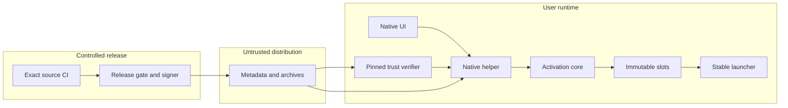

# Native updater threat model

## Executive summary

The highest risks are accepting unauthenticated/replayed update metadata,
extracting attacker-selected ZIP paths, activating incomplete bytes, and
confusing a developer build receipt with a public release authorization.
The implementation is in progress. The boundaries below are design and test
requirements, not a claim that all controls have passed acceptance.

## Scope and assumptions

The user confirmed anonymous public downloads, ordinary-user Windows x64
installation, untrusted networks/CDNs/cache files, and exclusion of malware
already able to replace programs as the same user or administrator. The app
updater does not update drivers, CUDA, PyTorch or independent research runtimes.
Production keys, protected publication configuration and public promotion
require separate authorization. No production root is currently configured.

In scope: `native/updater`, `native/updater-trust`, `NativeUpdate*`,
`NativeActivation*`, the stable launcher, and `packaging/updates`. CI/dev
packaging is a separate trust zone from the public helper. User models,
projects, photos and training processes are never updater cleanup targets.

Open production choices: release identity/key custody, approved complete CI
policy, protected signing environment, immutable asset host, first trusted
bootstrap migration and production recovery contact/runbook.

## System model

### Primary components

The existing stable launcher resolves `current.json` into an immutable slot
(`native/src/NativeInstallation.cpp`, `resolveNativeInstallation`). A new native
helper will independently obtain a typed offer from the linked tough verifier,
download it with Qt Network and publish through the shared activation core
(`native/updater/CMakeLists.txt`, `native/src/NativeActivationCore.h`). The
separate developer publisher is not a public helper option
(`NativeDeveloperPublisher.cpp`). Production and fixture trust builds are
separate (`native/updater-trust/Cargo.toml`, feature `fixture-profile`).

### Data flows and trust boundaries

- Internet/CDN → trust library: bounded HTTPS TUF role bytes and signed target;
  pinned compiled seed root, thresholds, expiry, role hashes/lengths and durable
  monotonic state must all pass before producing an offer.
- GUI → helper: intent/channel only; no caller-provided verification result,
  root key, feed, installation root or unsafe TLS option.
- Signed offer → Qt download: fixed package identity/length/digest, HTTPS host
  allowlist, bounded redirects/retries, strong-ETag resumable bytes. Byte hash
  success is not publisher authorization (`NativeUpdateDownload.h`).
- Archive/cache → activation: held file handle, full manifest and exact file
  set, portable Windows path/type checks and byte hashes before slot completion.
- Activation → launcher: exclusive shared `.publish.lock`, immutable new slot,
  atomic pointer last; existing bootstrap and running slots stay unchanged.
- CI → publisher: exact source/tree, pinned approved complete policy plus
  effective GitHub requirements and exact attempt/artifact evidence. Local
  `fullAcceptance` is not a release signature (`verify_native_release_gate.py`).

#### Diagram

## Assets and security objectives

| Asset | Why it matters | Security objective |
| --- | --- | --- |
| Executable slot and stable entry | Update compromise means user-code execution | I/A |
| Root history, release high-water marks, revocations | Must survive cancellation and app rollback | I/A |
| Projects/photos/checkpoints/runtime configuration | Irreplaceable user work; outside update ownership | C/I/A |
| Signing identity and CI source/artifact binding | Authorizes public executable distribution | C/I |
| Corresponding source and licenses | Reproducible, auditable GPL distribution | I/A |

## Attacker model

### Capabilities

Attackers may control network responses, stale CDN data, archive contents,
HTTP redirects, interrupted downloads and untrusted PR artifacts. A compromised
online target key is considered in key-rotation/revocation tests.

### Non-capabilities

The network attacker cannot replace the compiled initial root or the stable
launcher directly, authorize protected production signing, or mutate arbitrary
files as the same Windows user. TUF is not an administrator-malware defense.

## Entry points and attack surfaces

| Surface | How reached | Trust boundary | Notes | Evidence |
| --- | --- | --- | --- | --- |
| Metadata roles | HTTPS discovery | Network to verifier | Strict parser, expiry and history required | `native/updater-trust` |
| Package bytes | Qt HTTPS | Network to cache | Range identity and actual digest | `NativeUpdateDownload.h` |
| ZIP headers and manifest | Cached archive | Bytes to filesystem | No automatic trusted path extraction | `NativeActivationCore.h` |
| Activation intent | Native helper request | UI to security owner | Helper must verify independently | `INTERFACE.md` task plan contract |
| CI/policy/artifact | Developer tooling | Checks to authorization | Draft policy must fail closed | `packaging/updates/release-policy.json` |
| Current pointer | Launcher filesystem | Install metadata to process | Recovery cannot depend on parsing a bad pointer | `NativeInstallation.cpp` |

## Top abuse paths

1. Replace an archive on a CDN → keep the filename → trick the GUI into calling
   it verified → execute attacker code. Independent TUF admission and full hashes
   must block this sequence.
2. Replay old signed metadata after B → attempt to install vulnerable A → erase
   high-water marks via rollback. Trust state must be separate and monotonic.
3. Put `../`, ADS, device names, links or case aliases in ZIP → write outside
   staging → replace the stable launcher. Preflight all names before extraction.
4. Interrupt after extraction but before pointer swap → leave an incomplete
   candidate → later treat it as complete. Completion receipt and pointer-last
   publication must distinguish these states.
5. Forge a successful artifact with the right filename → bypass failed/missing
   checks → sign it. Exact commit/tree/attempt/artifact readback is mandatory.
6. Return changed ETag/range bytes → mix two package versions during resume →
   publish corruption. Identity validator, safe restart and final hash block it.
7. Corrupt current.json → deny app startup and recovery → force an insecure
   reinstall. Explicit independent recovery must use accepted slot evidence.

## Threat model table

| Threat ID | Threat source | Prerequisites | Threat action | Impact | Impacted assets | Existing controls (evidence) | Gaps | Recommended mitigations | Detection ideas | Likelihood | Impact severity | Priority |
| --- | --- | --- | --- | --- | --- | --- | --- | --- | --- | --- | --- | --- |
| TM-001 | CDN/network | Control downloaded bytes | Substitute unsigned or mixed metadata/package | Code execution | Program | Production stub fails `NOT_CONFIGURED`; tough pinned | Full implementation/tests pending | Independently verify inside helper; no public bypass | Stable stage/error codes | medium: distribution is exposed | high: executable replacement | high |
| TM-002 | Replay/key attacker | Stale signed data or compromised role | Downgrade, expiry bypass or rollback state reset | Vulnerable code returns | Trust ledger | Separate durable journal design in trust crate | Rotation/crash tests pending | Atomic root history, expiry, high-water and revocation checks | Metadata versions/reason codes | medium: CDN replay plausible | high: persistent downgrade | high |
| TM-003 | Archive author | Can supply package candidate | Path traversal/alias/link or decompression bomb | Overwrite/data loss | Filesystem/user data | Bounded package producer (`package_native_update.py`) | Native reader acceptance pending | Preflight all entries, held handles, exact set/hash, resource budgets | Rejected entry category only | medium: malformed archives easy | high: write escape | high |
| TM-004 | Concurrent process/failure | Repeated update/crash/occupied files | Publish incomplete or mixed slot | App unavailable | Current slot/entry | Exclusive lock interface; old immutable layout | Native transaction tests pending | Shared lock, complete receipt, atomic pointer last, recovery | Transaction phase/build ID | medium: common failures | medium: recoverable if A retained | medium |
| TM-005 | CI/artifact attacker | Untrusted artifact or ambiguous check identity | Sign wrong source/failed build | Authorized malicious release | Release identity | Draft policy `approved:false` | Protected prod config absent | Pinned complete policy, effective rules union, exact attempt and readback | Gate evidence digest | medium: CI inputs complex | high: fleet compromise | high |
| TM-006 | Server/network | Disconnect/range manipulation | Mix partial bytes or hang update | Availability/corrupt cache | Download cache | Explicit length/hash policy (`NativeUpdateDownload.h`) | Full ETag matrix pending | Strong ETag only, bounded redirects/timeouts/retries, safe restart | Byte counts/state, no URL secrets | high: disconnects routine | medium: A should still launch | medium |
| TM-007 | Bug/operator | Cleanup or runtime migration enabled | Delete running slot, checkpoint or runtime | Work loss/training failure | User data/runtimes | Initial design retains all version slots | Installed lifecycle proof pending | Never prune slots initially; own only cache/staging | Owned-path cleanup records | low: no cleanup feature yet | high: irreplaceable work | medium |

## Criticality calibration

- critical: remotely distributed executable accepted without publisher authority;
  protected signer credentials exposed to an untrusted PR.
- high: ZIP writes escape installation ownership; replay bypass restores a
  revoked executable; artifact identity mismatch is signed.
- medium: bad range creates retryable cache failure; crash leaves an orphan
  staging slot; recoverable pointer corruption with A intact.
- low: cosmetic progress wording without state ambiguity; redundant retained
  cache bytes within the explicit budget.

## Focus paths for security review

| Path | Why it matters | Related Threat IDs |
| --- | --- | --- |
| `native/updater-trust/src` | Authentication, parsing and durable monotonic state | TM-001, TM-002 |
| `native/third_party/tough` | Minimal upstream storage/root-fetch patch | TM-001, TM-002 |
| `native/src/NativeUpdateDownload.cpp` | HTTPS, redirect, range, cancellation | TM-006 |
| `native/src/NativeActivationCore.cpp` | Untrusted ZIP to atomic filesystem publication | TM-003, TM-004 |
| `native/src/NativeLauncher.cpp` | Stable launch and independent recovery | TM-004 |
| `scripts/verify_native_release_gate.py` | CI identity and approval boundary | TM-005 |
| `scripts/package_native_update.py` | Hidden corresponding-source completeness | TM-003, TM-005 |
| `.github/workflows/native-auto-update.yml` | Test-only permissions and evidence scope | TM-005 |

## Notes on use

User assumptions were confirmed before this document. Runtime, CI/dev and
fixtures are separated; all discovered boundaries have an abuse path above.
Tests must update `STATUS.md` with actual run/SHA evidence. This document is not
a production security certification and does not authorize production secrets,
public uploads or channel promotion.
